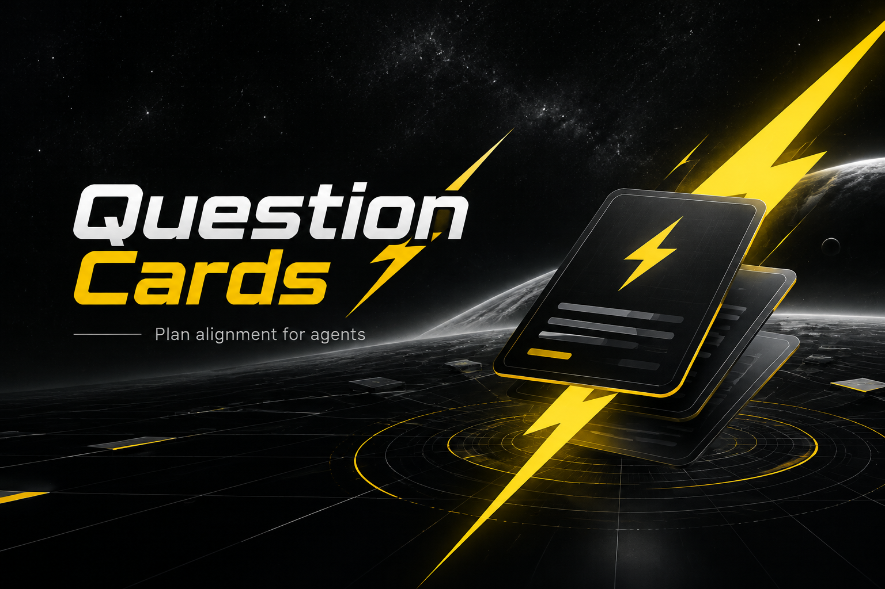
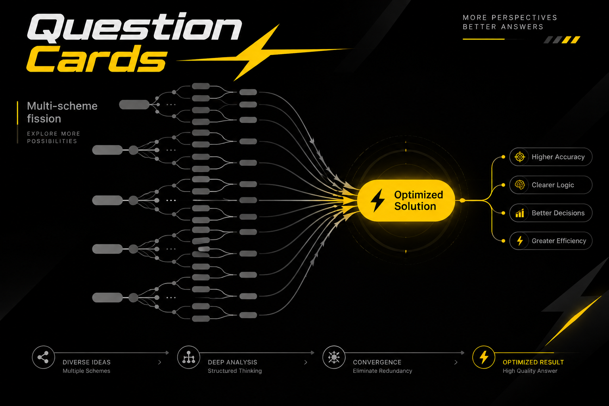
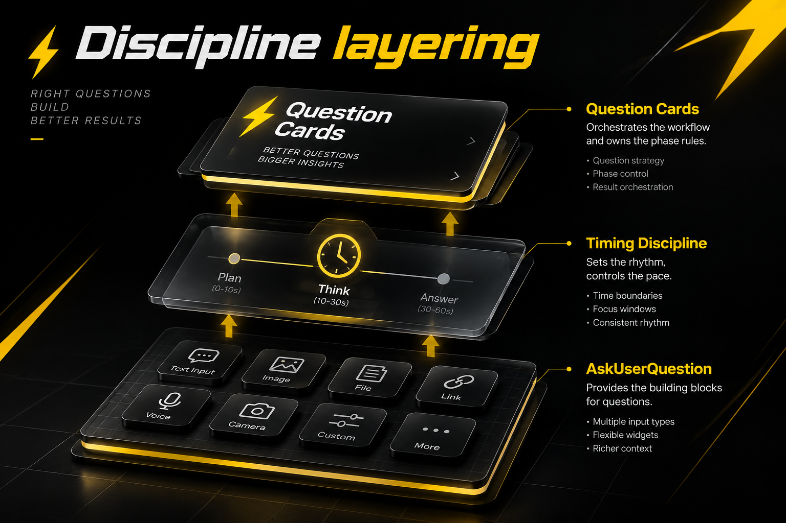
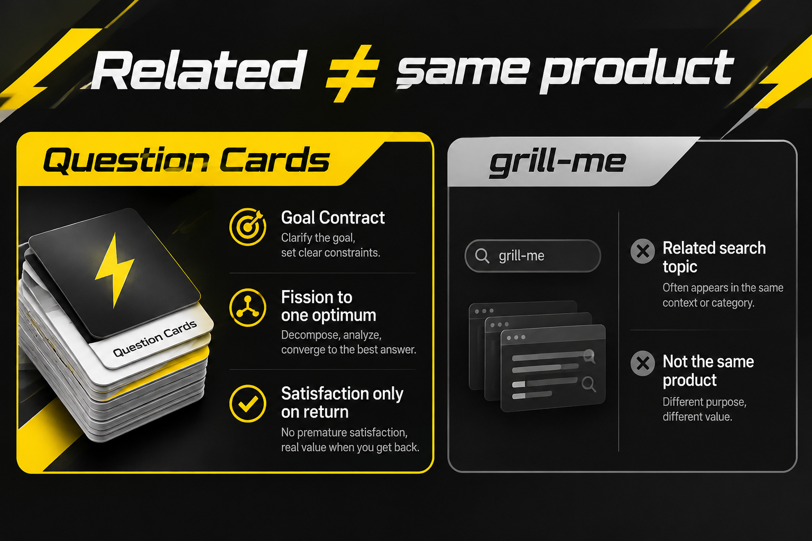
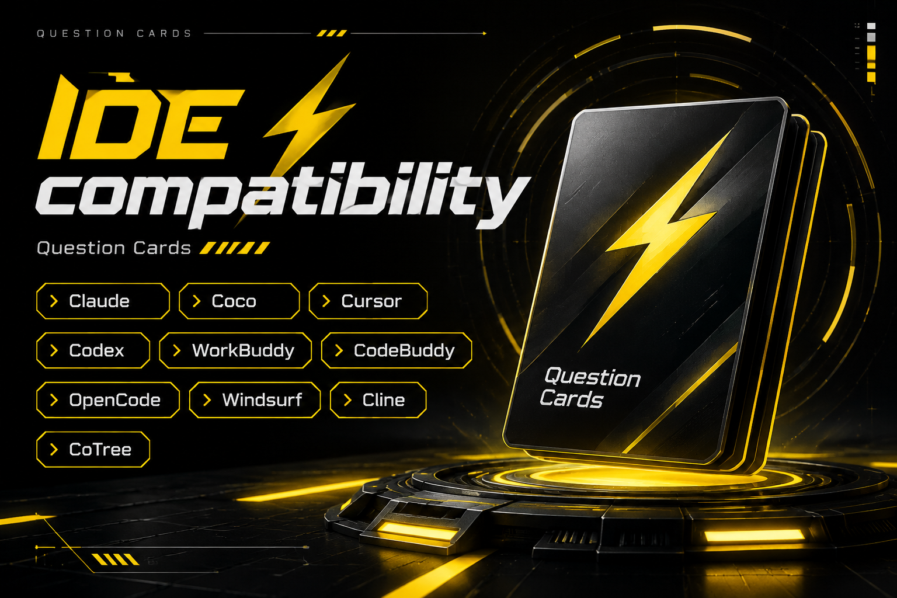
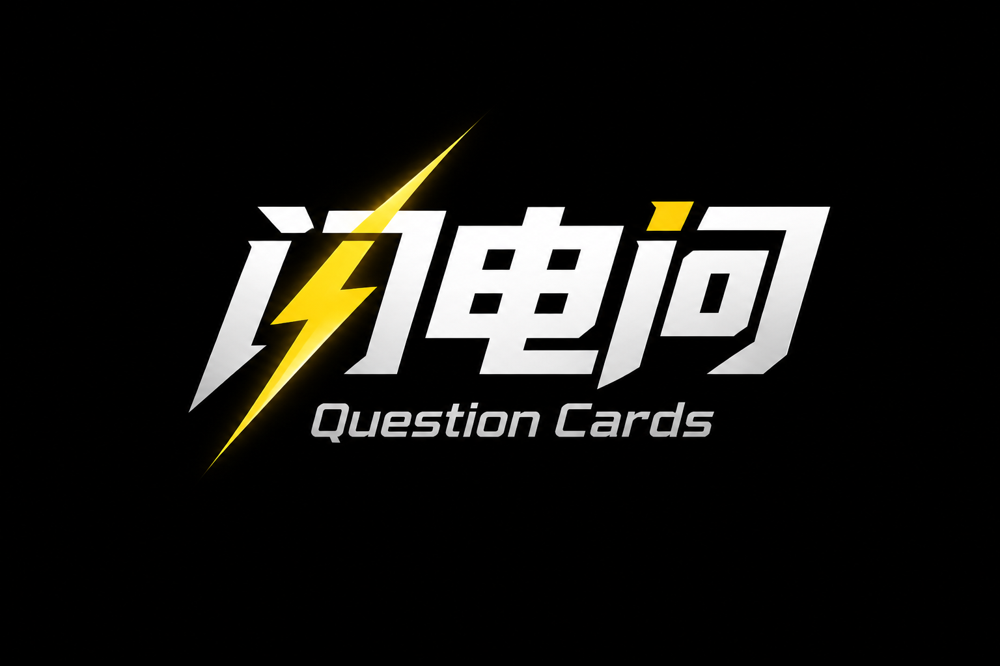

# CoT Question Cards

**Public Agent Skill** for aligning any plan or design — without mid-flight A/B votes.

**Macro Cards → private Multi-Scheme Fission → exactly one Optimized Solution → execute → Post-Execution Regression (Satisfied Card only then).**

[](LICENSE)
[](#installation)
[](#installation)
[](#positioning-versus-grill-me-grilling-and-askuserquestion)
[](#seo-and-discovery-keywords)

> **External product name (English):** **CoT Question Cards** (Chain of Thought Question Cards).  
> **Never brand this product as Grill, grill-me, grilling, or grill-with-docs.** Those names belong to related prior art and search neighborhoods; this skill is a different loop with Hard Timing rules. The Chinese product name lives only in the Chinese appendix at the end of this README — never use the common mistranslation that means “question card” as the product name.

**Repository:** [https://github.com/StockOnLLC/cot-question-cards](https://github.com/StockOnLLC/cot-question-cards)


<p align="center">
  
</p>

### Brand visuals










**Skill bodies:**
- Core loop (canonical): [`skills/question-cards/SKILL.md`](./skills/question-cards/SKILL.md)
- Compat alias: [`skills/cot-question-cards/SKILL.md`](./skills/cot-question-cards/SKILL.md) → points to `question-cards`
- Lightweight companion: [`skills/choice-cards/SKILL.md`](./skills/choice-cards/SKILL.md)

---

## Table of contents

1. [TL;DR](#tldr)
2. [Problem statement](#problem-statement-why-interview-skills-stall-teams)
3. [Positioning versus grill-me, grilling, and AskUserQuestion](#positioning-versus-grill-me-grilling-and-askuserquestion)
4. [Audience personas](#audience-personas)
5. [Hard Timing rule](#hard-timing-rule-non-negotiable)
6. [Master Loop overview (Phases 0–4)](#master-loop-overview-phases-04)
7. [Phase 0 — First Principles](#phase-0--first-principles-private)
8. [Phase 1 — Macro Cards only](#phase-1--macro-cards-only)
9. [Goal Contract deep dive](#goal-contract-deep-dive)
10. [Phase 2 — Multi-Scheme Fission](#phase-2--multi-scheme-fission-agent-private)
11. [Phase 3 — Execute + Post-Execution Regression](#phase-3--execute-the-unique-optimized-solution--post-execution-regression)
12. [Phase 4 — Micro tweak](#phase-4--micro-tweak-default-off)
13. [Card UX by host](#card-ux-by-host)
14. [Installation](#installation)
15. [Suite layout](#suite-layout)
16. [Worked examples](#worked-examples)
17. [Migration guide from grill-me / grilling](#migration-guide-from-grill-me--grilling)
18. [Anti-patterns catalog](#anti-patterns-catalog)
19. [End artifact template](#end-artifact-template)
20. [Relationship to Code Fission](#relationship-to-code-fission-and-design-trees)
21. [FAQ](#faq)
22. [Glossary](#glossary)
23. [SEO and discovery keywords](#seo-and-discovery-keywords)
24. [Contributing](#contributing)
25. [License](#license)
26. [Links](#links)
27. [Appendices](#appendices)
28. [Chinese appendix](#chinese-appendix)

---

## TL;DR

| You get | You do not get |
| --- | --- |
| Clear success criteria via **Macro Cards** | Three to five half-baked options dumped for you to vote |
| Agent **internally** expands 2–5 schemes, gates them, keeps **one** champion | Mid-fission “which do you prefer?” preference polls |
| A **Goal Contract** written from your answers (no confirm-card spam) | “Are you happy?” before anything shipped |
| A **Satisfied Card only after execute** (Post-Execution Regression) | Satisfaction glued to the first swipe deck of Macro Cards |
| Card UX compatible with `AskUserQuestion`, `AskQuestion`, `request_user_input`, and Grok Bot widgets | A product branded as Grill |

**One sentence:** Question Cards is an Agent Skill (`SKILL.md`) that keeps structured question widgets for plan alignment and design interview work, but forbids mid-loop scheme voting and forbids Satisfied Cards until the unique Optimized Solution has been executed.

**Five beats:**

1. **Phase 0 — First Principles** (private): surface ask vs bedrock assumptions vs inherited assumptions.
2. **Phase 1 — Macro Cards** only (2–3 load-bearing). No Satisfied Card. No “adopt Optimized Solution” card.
3. Agent writes the **Goal Contract** privately → Phase 2 **Multi-Scheme Fission** (2–5 schemes) → gates → **exactly one** Optimized Solution.
4. **Execute** that Optimized Solution end-to-end.
5. **Phase 3 Post-Execution Regression** — **only now** ask satisfied / not satisfied; recurse or rewrite the Goal Contract until confirmed.

---

## Problem statement: why interview skills stall teams

The Agent Skills ecosystem exploded around structured interviews. People search for **grill-me**, **grilling**, **grill-with-docs**, **AskUserQuestion**, **AskQuestion**, **request_user_input**, **choice cards**, **choice-cards**, **Socratic interview**, **plan alignment**, **design interview**, **spec sharpening**, and **product discovery**. Those searches are healthy. The failure mode is not “asking questions.” The failure mode is **when** and **what** gets asked.

### Failure mode 1 — Mid-fission preference votes

A typical grill-me or grilling session surfaces several partial schemes and asks the human to pick. That feels collaborative. In practice it:

- Forces the user to compare incomplete designs without gates
- Turns the Agent into a waiter instead of a decision engine
- Creates decision fatigue before any Optimized Solution exists
- Confuses **macro goal clarity** with **micro implementation taste**

Question Cards treats Multi-Scheme Fission as **Agent-private**. The user never sees a shortlist of half-baked winners mid-loop. The Agent expands schemes, applies hard gates and guardrails, and returns **exactly one** Optimized Solution.

### Failure mode 2 — Satisfaction asked too early

Many card UIs make it easy to append “Are you satisfied?” to the first swipe group. That destroys the regression loop. Satisfaction before execution is theater: there is nothing concrete to be satisfied about. Question Cards hard-codes the opposite:

> Satisfied / not-satisfied cards **MUST NOT** appear with Phase 1 Macro Cards. Ask satisfied **only after** (1) the user answered Phase 1, (2) the Agent delivered the unique Optimized Solution **and executed it**, (3) the **Post-Execution Regression** round.

### Failure mode 3 — Mixing macro and micro in one deck

Macro questions ask what success is, for whom, and what is out of scope. Micro questions ask which module, which API, which button color. Mixing them in one AskUserQuestion / AskQuestion / request_user_input deck creates false precision: the user “decides” implementation details before the Goal Contract exists. Question Cards forbids micro preference votes during Phase 1 and Phase 2.

### Failure mode 4 — Naming collision with Grill

Teams searching for grill-me, grilling, Builder.io grill-me, nicolasgalvez grilling, or “Grill the plan” often want structured cards. If your product also brands itself Grill, you inherit their timing habits and SEO confusion. **Question Cards** keeps the card UX neighborhood (AskUserQuestion family, choice cards, question widgets) while owning a distinct loop name and a distinct Hard Timing rule.

### Failure mode 5 — No execute step

Some interview skills stop at “shared understanding.” Shared understanding without shipping is unfinished work. Question Cards requires the Agent to **deliver and execute** the unique Optimized Solution before opening the regression Satisfied Card. Execution may mean: push a repo, publish a skill, update a config, write the PR, configure topics — whatever the Goal Contract defined as done.

### Failure mode 6 — Inherited assumptions smuggled into the goal

Fashion (“everyone uses grill-me”), vendor defaults, and analogy can sneak into success criteria. Phase 0 First Principles forces a private split between **bedrock** and **inherited** before Macro Cards open.

### Why Agent Skills make this worse if timing is wrong

Modern hosts — Claude Code, Coco, Cursor, OpenAI Codex, WorkBuddy, CodeBuddy, OpenCode, Gemini CLI, Windsurf, Cline, Continue, Trae, Zed, Copilot, CoTree, Grok Bot, and more — make cards cheap. `AskUserQuestion`, `AskQuestion`, `request_user_input`, and in-chat widgets lower the friction of asking. Lower friction without timing discipline means more mid-loop votes. Question Cards is the timing discipline layer on top of those card primitives.

### What “high information density” means for this skill

Readers and search engines should leave knowing:

- How Macro Cards differ from micro preference polls
- When the Satisfied Card is legal
- How Goal Contract differs from Optimized Solution
- How Multi-Scheme Fission stays Agent-private
- How this relates to grill-me, grilling, grill-with-docs, AskUserQuestion, choice-cards, agentskills.io, anthropics/skills, Terminal Skills, `npx skills add`, plugin marketplace, CLAUDE.md, and AGENTS.md

That is why this document stays long on purpose — without claiming ownership of Builder.io grill-me, nicolasgalvez grilling, Matt Pocock-style skills ecosystems, Filip Hric interactive SKILL.md notes, or Anthropic’s anthropics/skills repository.

---

## Positioning versus grill-me, grilling, and AskUserQuestion

### Short comparison table

| Dimension | grill-me / grilling (typical) | AskUserQuestion / AskQuestion / request_user_input alone | choice-cards companion | Question Cards |
| --- | --- | --- | --- | --- |
| Primary job | Relentless interview / shared understanding | Collect answers via structured UI | One-off A/B/C pick | Plan/design alignment with Hard Timing |
| Mid-fission votes | Often yes | Possible if author dumps schemes | N/A (single pick) | **Forbidden** |
| Satisfied timing | Often early or ad hoc | Author-dependent | N/A | **Post-Execution Regression only** |
| Output shape | Shared understanding / plan text | Answers to questions | A single pick | **Exactly one** Optimized Solution + **execute** |
| Naming | Grill / grill-me / grilling | Tool names | choice-cards | **CoT Question Cards** |

### What we borrow (inspiration, not forks)

- [Builder.io grill-me](https://www.skills.sh/builderio/builder-agent-skills/grill-me) — relentless plan interview patterns
- [nicolasgalvez grilling](https://www.skills.sh/nicolasgalvez/skills/grilling) and grill-with-docs style flows
- AskUserQuestion / AskQuestion / request_user_input card UX muscle memory
- choice-cards style option density for Phase 1 / Phase 3 only
- Code Fission-style select-one-champion skeleton (plan layer only)
- Agent Skills packaging (`SKILL.md`, agentskills.io / Terminal Skills / `npx skills add`)

We reject: branding as Grill; mid-fission A/B votes; Satisfied Cards in the Phase 1 swipe group; stopping at “alignment” without an executed Optimized Solution.

### AskUserQuestion is a tool; Question Cards is a loop

AskUserQuestion (Claude Code), AskQuestion (Cursor), and request_user_input (Codex) are **primitives**. Question Cards is the **Master Loop** that decides *when* those primitives may fire and *what* they may ask.

### choice-cards is a companion, not a replacement

The companion skill [`skills/choice-cards/SKILL.md`](./skills/choice-cards/SKILL.md) handles one-off A/B/C picks with no decision tree. If you need plan alignment, design interview, Goal Contract, Multi-Scheme Fission, unique Optimized Solution, execute, and Post-Execution Regression — use **Question Cards**, not choice-cards.

### Frontier questions and design trees

Frontier-style “keep asking until the tree is sharp” energy is welcome in Phase 1 Macro Cards. Design trees that reopen every micro branch mid-fission are not. Macro clarity first; Agent fission second; execute third; Satisfied Card last.

---

## Audience personas

### Persona 1 — Founder / PM sharpening a Goal Contract

You need checkable success criteria before engineering burns a week. You have used grill-me or grilling before and liked the pressure, but you hated voting on three incomplete roadmaps. You want Question Cards to ask Macro Cards, write a Goal Contract, deliver one Optimized Solution, and actually ship the first slice before asking if you are satisfied.

### Persona 2 — Agent Skill author packaging for Claude Code / Cursor / Codex

You maintain `SKILL.md` files, care about agentskills.io discovery, `npx skills add`, plugin marketplace metadata, CLAUDE.md, and AGENTS.md. You want a public skill that SEO-connects to AskUserQuestion, choice cards, grill-me, and plan alignment — while teaching a stricter loop. You install Question Cards as a Claude Code skill, Cursor skill, Codex skill, or Grok Bot skill.

### Persona 3 — Staff engineer tired of mid-design polls

Your Agent keeps opening AskQuestion decks mid-refactor. You want the Agent to hold Multi-Scheme Fission privately, gate schemes, and present one Optimized Solution with rollback notes. You will answer Phase 1 Macro Cards; you refuse to pick between Scheme B and Scheme D before gates run.

### Persona 4 — Bilingual product org (English docs, non-English operators)

You need English-first docs for SEO and GitHub, plus a short native-language appendix for operators. English body stays pure English; the Chinese appendix sits only at the end.

### Persona 5 — Team migrating off grill-me / grilling

You already have muscle memory for Socratic interview skills. You want a migration path: keep card UX, drop Grill branding, adopt Goal Contract + unique Optimized Solution + execute-before-satisfied. See the [Migration guide](#migration-guide-from-grill-me--grilling).

### Persona 6 — OpenCode / multi-host agent runner

You run OpenCode, Gemini CLI, Windsurf, Cline, CoTree/contree, or a fleet of Agent Skills clients. You need one `SKILL.md` that copies into many roots with concrete paths — not a handwave.

---

## Hard Timing rule (non-negotiable)

### The rule

1. **Satisfied Cards MUST NOT appear with Phase 1 Macro Cards.**
2. Ask **satisfied only after all** of:
   - The user answered Phase 1 Macro Cards (clarity exit met).
   - The Agent completed Phase 2 Multi-Scheme Fission and selected **exactly one** Optimized Solution.
   - The Agent **delivered and executed** that Optimized Solution (ship / push / apply / publish — as defined by the Goal Contract).
   - You are in the **Post-Execution Regression** round.
3. Do not phrase a Goal Contract lock as “adopt Optimized Solution.” Adopting happens at regression after execution evidence exists.

### Why the rule exists

Without this rule, Question Cards collapses into generic grilling with nicer labels. The Satisfied Card is powerful precisely because it is scarce. Scarcity forces the Agent to finish work before seeking approval theater.

### What “execute” means

Execute is Goal-Contract-defined done, not vibes. Examples:

- Push / open the PR that implements the Optimized Solution
- Publish the skill / listing / config change
- Apply the migration and verify a checkable metric
- Ship the experiment slice and confirm the primary event fires

If nothing executed, you may not open the Satisfied Card. You may still show the Optimized Solution prose **without** a satisfaction widget — then execute — then regress.

### Regression outcomes (only legal after execute)

- **Satisfied — adopt / close** — freeze Goal Contract and Optimized Solution; close the loop
- **Not satisfied — recurse** — capture concrete feedback → Phase 2 again → new unique Optimized Solution → execute again → ask satisfied again
- **Macro gate wrong** — return to Phase 1; rewrite Goal Contract; do not pretend a micro re-fission will fix a wrong success criterion

### Two unsatisfied rounds that are actually macro

If feedback twice is really “success was wrong,” force Phase 1. Do not spin Phase 2 forever on a bad Goal Contract.

---

## Master Loop overview (Phases 0–4)

```text
Phase 0  First Principles (private)
         surface ask | bedrock | inherited

Phase 1  Macro Cards only (2–3 load-bearing)
         clarity exit → Agent writes Goal Contract (no card)
         NO Satisfied Card | NO adopt-Optimized-Solution card

Phase 2  Multi-Scheme Recursive Fission (Agent-private)
         seed → expand 2–5 → gate → exactly one Optimized Solution

Phase 3  Deliver Optimized Solution (prose, no Satisfied Card)
         EXECUTE end-to-end
         Post-Execution Regression → Satisfied Card only now
         recurse / rewrite Goal Contract until confirmed

Phase 4  Micro tweak (default OFF; user-explicit only)
```

### Loop invariants

1. **Hard Timing** is never optional.
2. **Macro Cards** before fission; micro preference votes never mid-fission.
3. **Goal Contract** is Agent-written after Phase 1; not a user confirm swipe.
4. **Optimized Solution** is singular. Dual champions are a bug.
5. **Execute** before Satisfied Card.
6. User language on cards; English on skill body and this README (Chinese only in the appendix).

### Mapping to host primitives

| Beat | Claude Code | Cursor | Codex | Grok Bot | OpenCode |
| --- | --- | --- | --- | --- | --- |
| Phase 1 Macro Cards | AskUserQuestion | AskQuestion | request_user_input | widgets / steps | question / ask_user |
| Phase 2 fission | silent | silent | silent | silent | silent |
| Deliver | Prose Optimized Solution | Prose | Prose | Prose | Prose |
| Phase 3 Satisfied Card | AskUserQuestion | AskQuestion | request_user_input | widgets | question / ask_user |

### Relationship to CLAUDE.md and AGENTS.md

Point hosts at the skill; do not paste the entire Master Loop into every rules file. A one-line pointer plus Hard Timing is enough:

```markdown
Plan / design alignment → skill question-cards (Question Cards).
Hard Timing: Satisfied Card only after execute.
```

---
## Phase 0 — First Principles (private)

### Steps

1. **Surface ask** — One sentence: what did the user literally request?
2. **Bedrock** — Hard / proven constraints (physics-like: time, money, safety, compliance, single Optimized Solution requirement, execute-before-satisfied).
3. **Inherited assumptions** — Habits, analogies, vendor defaults, or “everyone uses grill-me” fashion that might be smuggled in.
4. Strip inherited out of the goal; surface them in Phase 1 Macro Card copy if they matter.

### First Principles versus Socratic interview theater

A Socratic interview that only asks clever questions can still accept inherited assumptions. First Principles work in Question Cards means: strip the ask to bedrock constraints before you design schemes.

### Examples of bedrock vs inherited

| Claim | Type | Why |
| --- | --- | --- |
| “Must ship under MIT” | Bedrock (if true) | Legal / license constraint |
| “Must support Claude Code + Cursor paths” | Bedrock (if Goal Contract says so) | Host compatibility target |
| “We should brand this Grill because grill-me ranks” | Inherited | SEO fashion; naming collision |
| “Users must vote on three roadmaps” | Inherited | Prior-art timing habit |

### Anti-patterns in Phase 0

- Treating “similar to Builder.io grill-me” as a bedrock product requirement
- Skipping Phase 0 and jumping to scheme brainstorms
- Showing a long First Principles essay instead of a short private split

---

## Phase 1 — Macro Cards only

### Ask only (gap-driven)

- **Success look like** — checkable, not adjectives
- **For whom / not for whom** — audience and non-audience
- **Out of scope** — explicit non-goals
- **Bedrock constraints** — hard limits, compliance, brand rules (including: external name is Question Cards, never Grill)
- **Cost of being wrong** — gate tightness

### Round structure

Round 1: **2–3 load-bearing Macro Cards**. Clarity exit = executable success criteria + no blocking fog. Else expand 1–3 cards on the foggy macro branch only. Do not open a new product tree.

### Forbidden in Phase 1

- Any **Satisfied / not satisfied / adopt Optimized Solution** card
- Bundling Goal-Contract confirm / start in the same swipe deck
- Phrasing contract lock as “adopt Optimized Solution”
- Dumping grill-me style multi-scheme choices “just to get signal”
- Micro preference votes (module, API, color, file layout)

### Card copy guidance

- Detailed question; short option labels
- Multi-Q prefix `①` `②` `③`
- Put Recommended first when the host supports descriptions
- Recommendations are hypotheses, not pre-chosen Optimized Solutions

### “You decide” / “whatever”

Phase 1 → take current Recommended / 🟢 and proceed. Do not stall.

### Clarity exit criteria

Phase 1 is done when the Agent can privately write a Goal Contract with checkable Success, Scope / non-goals, Bedrock, Gates, and Regression lines — without guessing on a blocking fog.

---

## Goal Contract deep dive

### When it is written

After Phase 1 clarity exit, **Agent-private**, with **no** user confirm card. Proceed to Phase 2 immediately.

### Template

```markdown
## Goal Contract
- Success: …
- Scope / non-goals: …
- Bedrock: …
- Gates: …
- Regression: ask satisfied only after the Optimized Solution is executed
```

### Field dictionary

| Field | Meaning |
| --- | --- |
| Success | Checkable. Prefer verbs and artifacts. Avoid “great SEO” without a proxy metric. |
| Scope / non-goals | What you will refuse. Example: do not rebrand Question Cards as Grill for keyword capture. |
| Bedrock | Hard constraints: safety, legal, brand (English external name Question Cards), host targets, license (MIT). |
| Gates | DQ rules for Phase 2 schemes (e.g. DQ mid-fission votes; DQ dual champions). |
| Regression | Satisfied only post-execute. |

### Worked Goal Contract — publishing this skill

```markdown
## Goal Contract
- Success: https://github.com/StockOnLLC/cot-question-cards is public; MIT LICENSE; README is English-first with Chinese appendix only; skills/question-cards/SKILL.md and skills/choice-cards/SKILL.md present; topics include agent-skill, question-cards, askuserquestion, grill-me (as related search), goal-contract, optimized-solution.
- Scope / non-goals: No Grill product branding; no bilingual mash in the English README body; no mid-fission user votes in the skill rules.
- Bedrock: External English name is Question Cards (id question-cards); Satisfied Card only post-execute; unique Optimized Solution required.
- Gates: DQ schemes that insert Satisfied Card into Phase 1; DQ dual champions.
- Regression: after cold install + toy Phase 1 (no satisfied option) + execute evidence.
```

### Worked Goal Contract — API redesign

```markdown
## Goal Contract
- Success: OpenAPI published; three critical clients green on staging; rollback playbook linked; error budget unchanged.
- Scope / non-goals: No UI redesign; no auth vendor change.
- Bedrock: Backward-compatible for 90 days; PII rules unchanged.
- Gates: DQ schemes without rollback; DQ mid-fission client-vote polls.
- Regression: after staging green evidence only.
```

### Worked Goal Contract — product discovery workshop

```markdown
## Goal Contract
- Success: One Optimized Solution for the onboarding experiment is live for 10% traffic; primary metric event fires; kill switch tested.
- Scope / non-goals: No full funnel rewrite.
- Bedrock: Privacy review passed; experiment ethics checklist done.
- Gates: DQ schemes requiring user to pick among incomplete funnels mid-fission.
- Regression: after live slice + event fire.
```

### Anti-patterns

- Using Goal Contract as a synonym for Optimized Solution (they are different artifacts)
- Asking the user to “confirm the Goal Contract” in the Phase 1 swipe group
- Writing Success as adjectives (“awesome”, “intuitive”) with no check

### Goal Contract versus Optimized Solution

| Artifact | Author | When | User card? | Shape |
| --- | --- | --- | --- | --- |
| Goal Contract | Agent | After Phase 1 | No | Success / scope / bedrock / gates / regression |
| Optimized Solution | Agent | After Phase 2 | No (prose deliver) | Singular champion design |

---

## Phase 2 — Multi-Scheme Fission (Agent-private)

Phase 2 borrows the **select-one-champion skeleton** from Code Fission-style inner loops, applied at the plan layer. Full Code Fission release tournaments stay in Code Fission proper. Question Cards expands **2–5** executable schemes (default 3, max 5), gates them, and keeps **exactly one** Optimized Solution.

### 2.1 Seed

From the Goal Contract: primary metric / gates, guardrails (brand rules, safety, “never call this Grill”, Hard Timing), seeds (1 default + ≤2 distinct directions).

### 2.2 Expand

One lever class per variant. Each scheme must include How, Fail/rollback, Fit, Risk, Lever. Agent order: write seed A → mutate one lever → B/C/(D/E) → fill table → gate. Self-research facts; BLOCKED variants stay out of ranking.

### 2.3 Gate and pick (Agent-only)

1. Hard gate fail → DQ  
2. Guardrail hit → DQ or demote  
3. Rank survivors → pick **one champion**  
4. Optional runner-up for one-line contrast only — never two winners  

**Output of Phase 2 is always a single Optimized Solution.**

### 2.4 Forbidden

- Mid-fission “which variant do you prefer?”
- Dumping 2–5 half-baked schemes for user multi-select
- Vibes without gates

### Lever classes worth mutating (examples)

Path / cut scope / integration order / feedback loop / data model / rollout strategy / observability / rollback shape / host adapter surface / docs vs code priority.

### Internal bake-off summary (not a user vote)

```markdown
## Internal bake-off
- Variants: N
- Passed gates: M
- Winner: …
- DQ one-liners: …
```

### Recursive planning inside Phase 2

If a gate cannot be judged without a user-only secret that changes Success, return **one** Phase 1 Macro Card — not a micro ask, not a scheme vote.

---

## Phase 3 — Execute the unique Optimized Solution + Post-Execution Regression

### Deliver (pre-execute, no Satisfied Card)

Short prose: how, why it passed gates, fail/rollback, key tradeoffs, one line on directions that lost. **No** satisfaction widget yet.

### Execute

Ship / push / apply / publish until Goal Contract Success is checkable. Log evidence in the Execution record.

### Open regression (Satisfied Card only now)

- 🟢 Satisfied — adopt / close  
- 🟡 Not satisfied — recurse (concrete feedback → Phase 2 → execute → ask again)  
- 🔴 Macro gate wrong → Phase 1  
- 🔵 Need expand  

### Regression rules

- Satisfied Card **only** post-execution
- Dissatisfaction needs specific feedback
- Two macro-shaped unsatisfied rounds → force Phase 1
- Loop continues until confirmed at regression

### Why execute-before-satisfied beats design-before-satisfied

Design praise without shipped evidence invents false consensus. Execution creates the object satisfaction can actually judge.

---

## Phase 4 — Micro tweak (default OFF)

Only if the user **explicitly** asks to choose one load-bearing detail **inside** the adopted Optimized Solution. ≤3 cards/round; clear → stop. No full-tree reopen. Never use Phase 4 to sneak mid-fission votes back in.

---

## Card UX by host

### Claude Code — AskUserQuestion

Phase 1 Macro Cards and Phase 3 Satisfied Card only. Phase 2 stays silent.

### Cursor — AskQuestion

Same timing. Prefer AskQuestion when available; text-card fallback always valid.

### OpenAI Codex — request_user_input

Enable interactive input for Phase 1 / 3; never for Phase 2 scheme dumps.

### Grok Bot — widgets / steps / allowCustom

Use `steps` for multi Macro Cards. Do not append Satisfied Card into the Phase 1 step group.

### OpenCode — question / ask_user

Map Phase 1 / 3 only.

### Text-card fallback (any host)

```text
① Question…
🟢 Option A (Recommended) — …
🟡 Option B — …
🔴 Option C — …
🔵 Need more detail
```

### choice-cards overlap

For a single pick with no tree, use choice-cards. For Master Loop work, use Question Cards.

### WorkBuddy / CodeBuddy — Import Skill + widgets

Import `skills/question-cards`; use structured widgets when present.

### Windsurf / Cline / Continue / Trae / Zed / Copilot / Roo / Goose / Amp / Junie

NL skill load + host card primitive or text-card fallback. Same Hard Timing.

### CoTree / contree — router, not a separate loop

CoTree installs `SKILL.md` into other hosts’ directories. Invoke inside the destination host. See Installation §18.

### Filip Hric-style interactive SKILL.md notes

Interactive skill authoring is fine — Hard Timing still binds Satisfied Card scarcity.

---
## Installation

Compatible with the **Agent Skills** layout (`SKILL.md` + YAML frontmatter). For each host: **project path**, **global path**, **invoke**, **debug**.  

**Canonical skill folder to copy:** `skills/question-cards` (and companion `skills/choice-cards`).  
**Skill id / frontmatter `name`:** **`question-cards`** (kebab-case; folder name must match).  
**Compat alias folder:** `skills/cot-question-cards` (thin redirect; prefer canonical for new installs).

**English product name:** Question Cards  
**Repo:** https://github.com/StockOnLLC/cot-question-cards  
**Related search nouns (not product identity):** question cards, AskUserQuestion, AskQuestion, request_user_input, choice-cards, grill-me, grilling, plan alignment, Goal Contract, Optimized Solution, Agent Skills, SKILL.md, Terminal Skills, agentskills.io, CoTree, contree

### Universal clone

```bash
git clone https://github.com/StockOnLLC/cot-question-cards.git
cd cot-question-cards
# Core skill body:
#   skills/question-cards/SKILL.md
# Compat alias (optional):
#   skills/cot-question-cards/SKILL.md
# Companion single-pick helper:
#   skills/choice-cards/SKILL.md
```

### Universal multi-agent installer (vercel-labs / skills / agentskills.io)

```bash
# Conceptual — exact flags follow your catalog version
npx skills add StockOnLLC/cot-question-cards
# or point at the skill subfolder explicitly if the installer supports it:
# npx skills add StockOnLLC/cot-question-cards/skills/question-cards
```

Verify the destination folder name is **`question-cards`** and frontmatter `name: question-cards`.

Debug: verbose/list flags → confirm path → restart host → check description triggers include “Question Cards”, “plan alignment”, “Goal Contract”, “Optimized Solution”.

### Master compatibility matrix (quick index)

| Host | Project path | Global / user path | Invoke | Debug / tune |
| --- | --- | --- | --- | --- |
| Claude Code / Coco | `.claude/skills/question-cards` | `~/.claude/skills/question-cards` | `/question-cards` or NL | CLAUDE.md pointer; restart; frontmatter |
| Cursor IDE + Cursor CLI | `.cursor/skills/` **and** `.agents/skills/` | `~/.cursor/skills/`, `~/.agents/skills/` | NL / agent skill picker | AGENTS.md; name = folder |
| OpenAI Codex | `.codex/skills/`, often `.agents/skills/` | `~/.codex/skills/` | NL + `request_user_input` | enable interactive input; restart |
| WorkBuddy / CodeBuddy | `.codebuddy/skills/` | `~/.codebuddy/skills/` | Settings → Import Skill; NL | re-import; YAML name |
| OpenCode | `.agents/skills/` or `.opencode/skills/` | `~/.config/opencode/skills/` | NL / `/question-cards` | opencode skills root |
| Gemini CLI | `.agents/skills/` | `~/.gemini/skills/` | NL | restart CLI; list skills |
| Windsurf | `.windsurf/skills/` | `~/.codeium/windsurf/skills/` | NL / Cascade skills | Cascade reload |
| Cline | `.agents/skills/` or `.cline/skills/` | `~/.agents/skills/` or `~/.cline/skills/` | NL | VS Code reload window |
| Continue.dev | `.continue/skills/` | `~/.continue/skills/` | NL / config | continue config |
| Trae | `.trae/skills/` | `~/.trae/skills/` | NL | restart Trae |
| Zed | `.agents/skills/` | `~/.agents/skills/` | NL / agent | Zed agent settings |
| GitHub Copilot Chat | `.agents/skills/` | `~/.copilot/skills/` | agent/skills or instructions paste | Copilot agents panel |
| Roo Code | `.roo/skills/` | `~/.roo/skills/` | NL | reload extension |
| Goose | `.goose/skills/` | `~/.config/goose/skills/` | NL / goose session | goose configure |
| Amp | `.agents/skills/` | `~/.config/agents/skills/` | NL | amp skills list |
| Junie (JetBrains) | `.junie/skills/` | `~/.junie/skills/` | NL | IDE restart |
| AiderDesk | `.aider-desk/skills/` | `~/.aider-desk/skills/` | NL | restart AiderDesk |
| Cortex / CoCo Snowflake | `.cortex/skills/` | `~/.snowflake/cortex/skills/` | NL | cortex skill list |
| Grok Build / Grok skill libs | `.grok/skills/` | `~/.grok/skills/` (+ bot libraries) | load skill name | bot skill library refresh |
| Kiro | `.kiro/skills/` | `~/.kiro/skills/` | NL | restart |
| Warp | `.agents/skills/` | `~/.agents/skills/` | Warp AI agent | Warp settings |
| Antigravity | `.agents/skills/` | `~/.gemini/antigravity/skills/` | NL | restart |
| CoTree / contree | targets other hosts’ dirs | via `contree skill install` specs | contree CLI | see CoTree section |
| VS Code + Copilot (no SKILL.md) | `.github/copilot-instructions.md` | user custom instructions | paste loop rules | instructions file |
| JetBrains AI Assistant | `.aiassistant/` / project docs | IDE AI settings | paste SKILL body / rules | AI Actions |
| Aider (classic) | `CONVENTIONS.md` / `.aider.conf.yml` | user conf | paste rules into conventions | aider conf |
| Web IDEs (Codespaces, Gitpod, …) | repo `.agents/skills/` or `.claude/skills/` | N/A ephemeral | clone + copy in terminal | re-copy after rebuild |
| OpenHands / Devin / Replit / Kilo / Hermes / Mistral Vibe / Crush / others | host-specific or `.agents/skills/` | see host docs | import SKILL.md | see per-host notes |

---

### 1. Claude Code / Coco

**Project path:** `.claude/skills/question-cards/SKILL.md`  
**Global path:** `~/.claude/skills/question-cards/SKILL.md`  
**Also used by:** Coco-branded Claude Code forks that still read `.claude/skills`.

```bash
mkdir -p ~/.claude/skills
cp -R skills/question-cards ~/.claude/skills/question-cards
cp -R skills/choice-cards ~/.claude/skills/choice-cards

mkdir -p .claude/skills
cp -R skills/question-cards .claude/skills/question-cards
cp -R skills/choice-cards .claude/skills/choice-cards
```

**Invoke:** `/question-cards` or NL (“use Question Cards to align this plan”, “Goal Contract with question cards timing”).  
**Optional `CLAUDE.md`:**

```markdown
For plan alignment / design interview / Goal Contract work, use the question-cards skill
(Question Cards). Obey Hard Timing: Satisfied Card only after execute.
```

**Debug:** `ls …/question-cards/SKILL.md` → `name: question-cards` matches folder → new session → tune `description:` triggers → Phase 1/3 via `AskUserQuestion`; Phase 2 silent.

---

### 2. Cursor IDE + Cursor CLI / Cursor agent

**Project paths:** `.cursor/skills/question-cards/` **and** `.agents/skills/question-cards/`  
**Global paths:** `~/.cursor/skills/question-cards/`, `~/.agents/skills/question-cards/`  
**Also loads:** project/user `.claude/skills` and `.codex/skills` on many Cursor builds.

**Critical Cursor rule:** frontmatter `name` **must** be kebab-case and **must** match the folder name (`question-cards`).

```bash
mkdir -p .cursor/skills .agents/skills
cp -R skills/question-cards .cursor/skills/question-cards
cp -R skills/choice-cards .cursor/skills/choice-cards
cp -R skills/question-cards .agents/skills/question-cards
cp -R skills/choice-cards .agents/skills/choice-cards

mkdir -p ~/.cursor/skills ~/.agents/skills
cp -R skills/question-cards ~/.cursor/skills/question-cards
cp -R skills/choice-cards ~/.cursor/skills/choice-cards
cp -R skills/question-cards ~/.agents/skills/question-cards
cp -R skills/choice-cards ~/.agents/skills/choice-cards
```

**Invoke:** “use Question Cards”, “align this with question-cards”.  
**Optional `AGENTS.md`:**

```markdown
Plan / design alignment → skill question-cards (Question Cards).
Hard Timing: no Satisfied Card until after execute.
Card primitive: AskQuestion for Phase 1 and Phase 3 Post-Execution Regression only.
```

**Debug:** folder === `name` → reload Cursor / CLI → try alternate root → tune description.

---

### 3. OpenAI Codex

**Project:** `.codex/skills/question-cards/`, often `.agents/skills/question-cards/`  
**Global:** `~/.codex/skills/question-cards/`

```bash
mkdir -p ~/.codex/skills .codex/skills .agents/skills
cp -R skills/question-cards ~/.codex/skills/question-cards
cp -R skills/choice-cards ~/.codex/skills/choice-cards
cp -R skills/question-cards .codex/skills/question-cards
cp -R skills/choice-cards .codex/skills/choice-cards
cp -R skills/question-cards .agents/skills/question-cards
```

**Invoke:** NL + `request_user_input` for Phase 1 / 3; text-card fallback always valid.  
**Debug:** confirm path → restart → interactive input enabled → Phase 2 stays silent.

---

### 4. WorkBuddy / CodeBuddy (Tencent)

**Project:** `.codebuddy/skills/question-cards/`  
**Global:** `~/.codebuddy/skills/question-cards/`  
**UI:** Settings → **Import Skill** (select `question-cards` folder or `SKILL.md`)

```bash
mkdir -p ~/.codebuddy/skills .codebuddy/skills
cp -R skills/question-cards ~/.codebuddy/skills/question-cards
cp -R skills/choice-cards ~/.codebuddy/skills/choice-cards
cp -R skills/question-cards .codebuddy/skills/question-cards
cp -R skills/choice-cards .codebuddy/skills/choice-cards
```

**Invoke:** skill name or NL (“Question Cards”). Prefer structured widgets when available.  
**Debug:** re-import → verify folder → restart → Import Skill error log.

---

### 5. OpenCode

**Project:** `.agents/skills/question-cards/` or `.opencode/skills/question-cards/`  
**Global:** `~/.config/opencode/skills/question-cards/`

```bash
mkdir -p ~/.config/opencode/skills .opencode/skills .agents/skills
cp -R skills/question-cards ~/.config/opencode/skills/question-cards
cp -R skills/choice-cards ~/.config/opencode/skills/choice-cards
cp -R skills/question-cards .opencode/skills/question-cards
cp -R skills/question-cards .agents/skills/question-cards
```

**Invoke:** NL or `/question-cards`; map Phase 1/3 to `question` / `ask_user`.  
**Debug:** confirm skills root in config → restart → list skills.

---

### 6. Gemini CLI

**Project:** `.agents/skills/question-cards/`  
**Global:** `~/.gemini/skills/question-cards/`

```bash
mkdir -p ~/.gemini/skills .agents/skills
cp -R skills/question-cards ~/.gemini/skills/question-cards
cp -R skills/choice-cards ~/.gemini/skills/choice-cards
cp -R skills/question-cards .agents/skills/question-cards
```

**Invoke:** NL with description triggers.  
**Debug:** `ls ~/.gemini/skills`; if Antigravity overlay, also `~/.gemini/antigravity/skills/`.

---

### 7. Grok Bot / Grok skill libraries / Grok Build

**Project:** `.grok/skills/question-cards/`  
**Global:** `~/.grok/skills/question-cards/`, often also `~/.agents/skills/`

```bash
mkdir -p ~/.grok/skills ~/.agents/skills .grok/skills
cp -R skills/question-cards ~/.grok/skills/question-cards
cp -R skills/choice-cards ~/.grok/skills/choice-cards
cp -R skills/question-cards ~/.agents/skills/question-cards
cp -R skills/question-cards .grok/skills/question-cards
```

**Invoke:** load **question-cards** / product name **Question Cards**. Widgets / steps / `allowCustom` for Phase 1 and Phase 3 only.  
**Debug:** refresh bot skill library; verify Satisfied Card not in macro swipe group.

---

### 8. Terminal Skills / npx skills add / agentskills.io catalogs

```bash
npx skills add StockOnLLC/cot-question-cards
# After install, verify destinations contain:
#   .../question-cards/SKILL.md
#   .../choice-cards/SKILL.md   # if companion selected
```

**Marketplace keywords:** Agent Skill, SKILL.md, Question Cards, question cards, AskUserQuestion, AskQuestion, request_user_input, choice-cards, Claude Code, Coco, Cursor, Codex, WorkBuddy, CodeBuddy, OpenCode, Gemini CLI, Windsurf, Cline, Continue, Trae, Zed, Copilot, Roo, Goose, Amp, Junie, AiderDesk, Cortex, Grok, Kiro, Warp, Antigravity, CoTree, contree, plan alignment, Goal Contract, Optimized Solution, grill-me (related), grilling (related).

---

### 9. Anthropic skills marketplace / plugin patterns

- Package `skills/question-cards` with valid frontmatter
- Register skill id `question-cards`
- Install into `~/.claude/skills/` or project `.claude/skills/`
- Do **not** claim this is an Anthropic product

**Debug:** marketplace installed list; reinstall if SKILL.md stale; plugin enablement.

---

### 10. VS Code + GitHub Copilot Chat

**When SKILL.md is supported:**

```bash
mkdir -p .agents/skills ~/.copilot/skills
cp -R skills/question-cards .agents/skills/question-cards
cp -R skills/question-cards ~/.copilot/skills/question-cards
```

**When SKILL.md is NOT loaded:** paste Hard Timing + Master Loop into `.github/copilot-instructions.md` or a Copilot prompt/agent. Forbid mid-scheme votes in instructions.

**Debug:** Copilot Chat agents panel → Reload Window → instructions fallback.

---

### 11. Windsurf

```bash
mkdir -p .windsurf/skills ~/.codeium/windsurf/skills
cp -R skills/question-cards .windsurf/skills/question-cards
cp -R skills/choice-cards .windsurf/skills/choice-cards
cp -R skills/question-cards ~/.codeium/windsurf/skills/question-cards
```

**Invoke:** Cascade / Windsurf agent NL. **Debug:** Cascade reload; Windsurf skills settings.

---

### 12. Cline (VS Code extension)

```bash
mkdir -p .cline/skills .agents/skills ~/.cline/skills ~/.agents/skills
cp -R skills/question-cards .cline/skills/question-cards
cp -R skills/question-cards .agents/skills/question-cards
cp -R skills/question-cards ~/.cline/skills/question-cards
```

**Invoke:** Cline chat NL. **Debug:** Reload Window; Cline skills path; output channel.

---

### 13. Continue.dev

```bash
mkdir -p .continue/skills ~/.continue/skills
cp -R skills/question-cards .continue/skills/question-cards
cp -R skills/question-cards ~/.continue/skills/question-cards
```

If your Continue version uses config assistants instead of SKILL.md, paste Master Loop rules into the assistant prompt and keep `SKILL.md` in-repo for other hosts.

---

### 14. Aider (classic) and AiderDesk

**AiderDesk:**

```bash
mkdir -p .aider-desk/skills ~/.aider-desk/skills
cp -R skills/question-cards .aider-desk/skills/question-cards
cp -R skills/question-cards ~/.aider-desk/skills/question-cards
```

**Classic Aider:** copy key rules into `CONVENTIONS.md` or `.aider.conf.yml` `read:`; keep `skills/question-cards/SKILL.md` in the repo for other tools.

---

### 15. Trae

```bash
mkdir -p .trae/skills ~/.trae/skills
cp -R skills/question-cards .trae/skills/question-cards
cp -R skills/question-cards ~/.trae/skills/question-cards
```

Restart Trae; confirm skills setting points at `.trae/skills`.

---

### 16. JetBrains AI Assistant / Junie / JetBrains IDEs

**Junie:**

```bash
mkdir -p .junie/skills ~/.junie/skills
cp -R skills/question-cards .junie/skills/question-cards
cp -R skills/question-cards ~/.junie/skills/question-cards
```

**Classic AI Assistant:** project AI rules summarizing Hard Timing, or paste SKILL body into a custom AI Action. Prefer Junie when available.

---

### 17. Zed

```bash
mkdir -p .agents/skills ~/.agents/skills
cp -R skills/question-cards .agents/skills/question-cards
cp -R skills/question-cards ~/.agents/skills/question-cards
```

Zed agent panel NL; check agent settings → skills roots.

---

### 18. CoTree / contree (ly-jq/CoTree ecosystem)

**What CoTree is here:** collaborator tooling that installs skills **into other agents’ directories** via specs such as `claude:~`, `codex:~`, `opencode:~`, `amp:~`, `cline:~`. CoTree does not replace those hosts; it **routes** `SKILL.md` into them.

| contree spec (illustrative) | Typical destination |
| --- | --- |
| `claude:~` | `~/.claude/skills/<id>` |
| `codex:~` | `~/.codex/skills/<id>` |
| `opencode:~` | `~/.config/opencode/skills/<id>` |
| `amp:~` | `~/.config/agents/skills/<id>` |
| `cline:~` | `~/.cline/skills/<id>` or `~/.agents/skills/<id>` |

**For THIS skill (`question-cards`):**

1. **Manual drop-in (always works):** copy `skills/question-cards` into every target directory your contree specs would use.
2. **Optional contree wrap:**

```bash
# Conceptual — follow your contree version’s help
contree skill install ./skills/question-cards --to claude:~ --to codex:~ --to opencode:~ --to amp:~ --to cline:~
# Then verify:
ls ~/.claude/skills/question-cards/SKILL.md
ls ~/.codex/skills/question-cards/SKILL.md
```

3. **If contree skill path is unavailable:** treat CoTree as an orchestrator docs/rules layer — keep `SKILL.md` in-repo and manually `cp -R` into the same dirs contree would use. **Native CoTree-only skills directory is not assumed.**

**Invoke after CoTree install:** inside the **destination** host (Claude Code `/question-cards`, Codex NL, Cline NL, …). CoTree itself is the installer/router.

**Debug:** `contree skill install --help` → list each destination `ls` → confirm kebab folder `question-cards` → unknown spec → manual copy from master matrix → copy companion `choice-cards` the same way when needed.

---

### 19. Web IDEs without durable local skills (Codespaces, Gitpod, StackBlitz-like, cloud VS Code)

Prefer **project-committed** skill folders (ephemeral home dirs wipe).

```bash
git clone https://github.com/StockOnLLC/cot-question-cards.git /tmp/question-cards
mkdir -p .claude/skills .agents/skills .cursor/skills .codex/skills
cp -R /tmp/question-cards/skills/question-cards .claude/skills/
cp -R /tmp/question-cards/skills/question-cards .agents/skills/
cp -R /tmp/question-cards/skills/question-cards .cursor/skills/
cp -R /tmp/question-cards/skills/choice-cards .agents/skills/
# Commit these into YOUR product repo if the cloud workspace is your project
```

Paste/import when no skills directory exists: open `skills/question-cards/SKILL.md` raw → paste into custom instructions / system prompt / agent starter → or host Upload skill UI. After rebuild, re-copy or rely on committed `.agents/skills/`.

---

### 20. Additional Agent Skills clients

Skill id remains `question-cards`.

#### Roo Code

```bash
mkdir -p .roo/skills ~/.roo/skills
cp -R skills/question-cards .roo/skills/question-cards
cp -R skills/question-cards ~/.roo/skills/question-cards
```

#### Goose

```bash
mkdir -p .goose/skills ~/.config/goose/skills
cp -R skills/question-cards .goose/skills/question-cards
cp -R skills/question-cards ~/.config/goose/skills/question-cards
```

#### Amp

```bash
mkdir -p .agents/skills ~/.config/agents/skills
cp -R skills/question-cards .agents/skills/question-cards
cp -R skills/question-cards ~/.config/agents/skills/question-cards
```

#### Kiro / Warp / Antigravity / Cortex

```bash
# Kiro
mkdir -p .kiro/skills ~/.kiro/skills
cp -R skills/question-cards .kiro/skills/question-cards
cp -R skills/question-cards ~/.kiro/skills/question-cards

# Warp
mkdir -p .agents/skills ~/.agents/skills
cp -R skills/question-cards .agents/skills/question-cards

# Antigravity
mkdir -p .agents/skills ~/.gemini/antigravity/skills
cp -R skills/question-cards ~/.gemini/antigravity/skills/question-cards
cp -R skills/question-cards .agents/skills/question-cards

# Cortex
mkdir -p .cortex/skills ~/.snowflake/cortex/skills
cp -R skills/question-cards .cortex/skills/question-cards
cp -R skills/question-cards ~/.snowflake/cortex/skills/question-cards
```

#### OpenHands / Devin / Replit / Kilo / Hermes / Mistral Vibe / Crush / others

Import `skills/question-cards/SKILL.md` into the host’s skill/prompt root when documented; otherwise paste Hard Timing + Master Loop into project agent instructions and keep the folder in-repo for hosts that do load Agent Skills.

---

### Frontmatter / write contract (all hosts)

```yaml
---
name: question-cards
description: >-
  Question Cards. Use when aligning a plan or design: Phase 1 Macro Cards only
  (no satisfaction); Agent Multi-Scheme Fission to one Optimized Solution then
  execute; ask Satisfied Card only at Post-Execution Regression. …
---
```

Rules: `name` kebab-case = folder name; description lists trigger phrases; body teaches Master Loop + Hard Timing; no Grill product branding.

### anthropics/skills and ecosystem etiquette

Related ecosystem, separate MIT skill. Do not imply Anthropic authorship.

### Verify install (any host)

1. `SKILL.md` exists at the expected path  
2. `name:` equals folder name `question-cards`  
3. Host restarted / window reloaded  
4. Toy Phase 1: Macro Cards appear; **no** Satisfied option in that deck  
5. After a fake/local execute, Satisfied Card appears only in regression  

### Smoke commands

```bash
test -f skills/question-cards/SKILL.md && echo ok-core
test -f skills/choice-cards/SKILL.md && echo ok-choice
grep -q 'name: question-cards' skills/question-cards/SKILL.md && echo ok-name
```

---
## Suite layout

```text
question-cards/
├── LICENSE
├── README.md
└── skills/
    ├── question-cards/
    │   └── SKILL.md          # canonical Master Loop (name: question-cards)
    ├── cot-question-cards/
    │   └── SKILL.md          # thin compat alias → question-cards
    └── choice-cards/
        └── SKILL.md          # one-off A/B/C companion
```

### Frontmatter expectations

Canonical: `name: question-cards`. Compat alias: `name: cot-question-cards` with pointer body only. choice-cards: `name: choice-cards`.

### Topics / GitHub discovery

Suggested topics: `agent-skill`, `agent-skills`, `skill-md`, `question-cards`, `askuserquestion`, `askquestion`, `plan-alignment`, `goal-contract`, `optimized-solution`, `design-interview`, `grill-me` (related search), `claude-code`, `cursor`, `codex`, `opencode`, `cotree`.

---

## Worked examples

### Example A — Product launch Goal Contract

**Context:** Ship a 10% onboarding experiment.  
**Phase 0:** Surface = experiment; bedrock = privacy + kill switch; inherited = “must A/B three full funnels with the user mid-design.”  
**Phase 1 Macro Cards:** success metric, audience, non-goals.  
**Goal Contract:** live 10% slice; primary event fires; kill switch tested.  
**Phase 2:** three schemes gated privately → one Optimized Solution.  
**Execute:** flag on, event verified.  
**Post-Execution Regression:** Satisfied Card only now.

### Example B — Agent Skill packaging and publish

**Context:** Publish this repo.  
**Phase 1 focus:** public MIT repo, English-first README, concrete install matrix, skill id `question-cards`.  
**Optimized Solution shape:** canonical `skills/question-cards`, compat alias, choice-cards companion, full host matrix including CoTree.  
**Execute evidence:** repo public, topics set, cold copy path works.  
**Regression:** after cold install smoke.

### Example C — Spec sharpening for an API redesign

**Corrective loop:** if staging fails a client, that is execute evidence → either re-fission with feedback or Phase 1 if Success was wrong — never mid-fission client popularity votes.

### Example D — Migrating a noisy grill-me session

**Before:** three incomplete roadmaps + early “are you happy?”  
**After (Question Cards):** Macro Cards → Goal Contract → private Multi-Scheme Fission → one Optimized Solution → execute → Satisfied Card.  
**Prompt rewrite:** “Grill me on this plan” → “Run Question Cards Hard Timing on this plan.”

### Example E — Recursive planning after a failed regression

**Correct:** concrete feedback → Phase 2 → new Optimized Solution → execute → ask again.  
**Incorrect:** open Satisfied Card again without execute; or dump three schemes for a vote.  
**Moral:** Post-Execution Regression is a loop, not a single yes/no theater.

---

## Migration guide from grill-me / grilling

1. **Inventory** — list where Grill branding and mid-fission votes appear.  
2. **Replace names** — product → Question Cards; keep grill-me only as related prior art.  
3. **Split templates** — Macro Cards vs regression Satisfied Card.  
4. **Ban mid-fission votes.**  
5. **Add Goal Contract + Optimized Solution artifacts.**  
6. **Add execute checklist** before Satisfied Card.  
7. **Install** `skills/question-cards/SKILL.md`.  
8. **Teach Hard Timing** with the illegal/legal sequences in Appendices.

AskUserQuestion muscle memory stays; timing changes.

---

## Anti-patterns catalog

| Anti-pattern | Fix |
| --- | --- |
| Satisfied Card in Phase 1 deck | Move to Post-Execution Regression only |
| Mid-fission A/B/C scheme vote | Agent-private Multi-Scheme Fission |
| Dual champions presented | Exactly one Optimized Solution |
| Goal Contract confirm swipe with macros | Agent writes Goal Contract privately |
| Branding as Grill / grill-me | CoT Question Cards only |
| Bilingual mash in English README body | Chinese appendix only at end |
| Stopping at “alignment” without execute | Execute before Satisfied Card |
| Micro polls during Phase 1/2 | Macro Cards only; micro = Agent or Phase 4 explicit |
| Infinite re-fission without feedback | Require concrete feedback; force Phase 1 if macro |
| Empty “you decide” stall | Take Recommended / 🟢 |

---

## End artifact template

```markdown
## Goal Contract
- Success: …
- Scope / non-goals: …
- Bedrock: …
- Gates: …
- Regression: Satisfied Card only after execute

## Optimized Solution (singular)
…

## Internal bake-off
- Variants: N; Passed: M; Winner: …; DQ one-liners: …

## Execution record
→ What shipped: …

## Post-Execution Regression
→ Satisfied close | Feedback → round k fission | Macro rewrite
```

---

## Relationship to Code Fission and design trees

Question Cards borrows the **select-one-champion skeleton** at the plan layer. Full Code Fission tournaments (many variants, real fixtures) stay in Code Fission proper. Design trees that reopen every micro branch mid-fission are out of scope until Phase 4 (explicit, optional).

---

## FAQ

### Is Question Cards just grill-me with a new name?

No. Related search neighborhood; different Hard Timing, Goal Contract, unique Optimized Solution, execute-before-satisfied.

### Can I still use AskUserQuestion?

Yes — as the Phase 1 / Phase 3 primitive. Question Cards is the loop that times it.

### Does this work as a Cursor skill and a Claude Code skill?

Yes. Same `SKILL.md`; see Installation matrix. Folder/id: `question-cards`.

### What about OpenAI Codex without request_user_input?

Use text-card fallback. Hard Timing still applies.

### How does choice-cards relate?

One-off picks. Master Loop → Question Cards.

### Why mention Matt Pocock-style skills ecosystems / Filip Hric / anthropics/skills / agentskills.io / Terminal Skills / npx skills add?

Discovery and packaging neighborhoods. We sit in Agent Skills; we do not claim those brands.

### Why mention CLAUDE.md and AGENTS.md?

Pointers to load the skill; do not dump the whole loop into every rules file.

### Can the Agent show me multiple schemes if I insist?

No mid-fission shortlist. One Optimized Solution. Contrast one-liners in bake-off prose only.

### What if I am satisfied with the design before execute?

Still execute first. Satisfied Card is post-execution only.

### What if execution is blocked on a secret only I know?

One Phase 1 Macro Card for the secret that changes gates — not a scheme vote.

### Is First Principles mandatory theater?

Private and short. Required before cards; not a user essay.

### How many Phase 1 cards?

2–3 load-bearing; expand 1–3 on foggy macro branches only.

### How many Phase 2 schemes?

2–5 (default 3, max 5) → exactly one Optimized Solution.

### What is the regression loop?

Post-Execution Regression with Satisfied Card; recurse or rewrite Goal Contract until confirmed.

### What is recursive planning here?

Feedback → Phase 2 (or Phase 1 if macro wrong) → new Optimized Solution → execute → ask again.

---

## Glossary

| Term | Meaning |
| --- | --- |
| Question Cards | English external product name |
| Macro Cards | Phase 1 load-bearing goal questions |
| Goal Contract | Agent-written success/scope/bedrock/gates/regression artifact |
| Multi-Scheme Fission | Agent-private expansion + gates of 2–5 schemes |
| Optimized Solution | Singular champion after Phase 2 |
| Hard Timing | Satisfied Card only after execute, in Post-Execution Regression |
| Satisfied Card | Regression satisfaction / adopt / close card |
| Post-Execution Regression | Phase 3 loop after execute |
| First Principles | Phase 0 bedrock vs inherited split |
| Master Loop | Phases 0–4 sequence |
| choice-cards | Companion one-off A/B/C skill |
| Agent Skills / SKILL.md | Packaging format |

---

## SEO and discovery keywords

**Primary:** Question Cards, Agent Skill, SKILL.md, plan alignment, Goal Contract, Optimized Solution, Hard Timing, Macro Cards, Multi-Scheme Fission, Post-Execution Regression, AskUserQuestion, AskQuestion, request_user_input, choice-cards.

**Hosts:** Claude Code, Coco, Cursor, Codex, WorkBuddy, CodeBuddy, OpenCode, Gemini CLI, Windsurf, Cline, Continue, Trae, Zed, Copilot, Roo, Goose, Amp, Junie, Aider, AiderDesk, Cortex, Grok, Kiro, Warp, Antigravity, CoTree, contree, Web IDEs, Codespaces, Gitpod.

**Related prior art (not identity):** grill-me, grilling, grill-with-docs, Builder.io grill-me, nicolasgalvez grilling, Socratic interview, design interview, spec sharpening, product discovery.

**Packaging:** agentskills.io, Terminal Skills, `npx skills add`, anthropics/skills, plugin marketplace, CLAUDE.md, AGENTS.md.

---

## Contributing

### Contribution guidelines

1. Keep English body free of Chinese characters; Chinese only in the Chinese appendix.  
2. Never brand as Grill / grill-me / grilling / grill-with-docs.  
3. Preserve Hard Timing and singular Optimized Solution.  
4. Update [`skills/question-cards/SKILL.md`](./skills/question-cards/SKILL.md) when behavior changes; keep README synchronized.  
5. Keep `cot-question-cards` as a thin alias only.  
6. When adding a host, include install path, card primitive, and a debug note.  
7. Use Title Case for key terms: Macro Cards, Goal Contract, Optimized Solution, Master Loop, Hard Timing, First Principles, Multi-Scheme Fission, Post-Execution Regression, Satisfied Card.

### Local preview

```bash
# read SKILL.md; install into a host skills directory; run a toy Phase 1
# confirm no Satisfied Card in Phase 1; execute; then regression
```

### Reporting timing bugs

File issues with: host, transcript snippet, which phase illegally showed Satisfied Card or mid-fission votes.

---

## License

MIT — see [LICENSE](LICENSE). Copyright (c) 2026 StockOn.

---

## Links

- Repo: [https://github.com/StockOnLLC/cot-question-cards](https://github.com/StockOnLLC/cot-question-cards)
- Core skill: [`skills/question-cards/SKILL.md`](./skills/question-cards/SKILL.md)
- Compat alias: [`skills/cot-question-cards/SKILL.md`](./skills/cot-question-cards/SKILL.md)
- Companion: [`skills/choice-cards/SKILL.md`](./skills/choice-cards/SKILL.md)

---

## Appendices

### Illegal vs legal card sequences

**Illegal A:** Phase 1 Macro Cards + Satisfied Card in same deck.  
**Illegal B:** Mid-fission “pick Scheme B or D.”  
**Illegal C:** “Confirm Goal Contract / adopt Optimized Solution” in Phase 1 swipe.  
**Illegal D:** Satisfied Card before any execute evidence.  

**Legal E:** Phase 1 macros → private Goal Contract → private fission → one Optimized Solution prose → execute → Satisfied Card.  
**Legal F:** Unsatisfied with feedback → Phase 2 → execute → Satisfied Card again.  
**Legal G:** Macro-wrong feedback → Phase 1 rewrite Goal Contract.  
**Legal H:** After adopt, user-explicit Phase 4 micro tweak (≤3 cards).

### Sample Phase 1 host framings

- Claude: AskUserQuestion with 2–3 macro options; no satisfied option.  
- Cursor: AskQuestion same.  
- Codex: request_user_input same.  
- Grok: widget steps; Satisfied Card not in the step group.  
- OpenCode: question / ask_user same.

### Sample regression skeleton

After execute evidence is shown: one Satisfied Card with adopt/close, recurse-with-feedback, macro-rewrite, expand.

### Mapping search intent to sections

| Intent | Section |
| --- | --- |
| Install Cursor / Claude / Codex / CoTree | Installation |
| vs grill-me | Positioning, Migration |
| When can I ask satisfied? | Hard Timing, Phase 3 |
| What is Goal Contract? | Goal Contract deep dive, Glossary |
| Optimized Solution meaning | Phase 2, Glossary |
| choice-cards | Positioning, Suite layout |

### Extended Goal Contract examples

**Internal tooling migration:** Success = cron jobs on new queue; old drain zero; runbook updated; rollback tested. Gates DQ dual-write skip and mid-fission votes. Regression after drain zero + runbook merged.

**Research protocol:** Pre-registration filed; sample size justified; primary endpoint defined; analysis dry-run. Regression after dry-run evidence.

**Support ops redesign:** First response SLA 14 days; escalation documented; templates live. Regression post-window.

**Skill marketplace listing:** Listing live; install works; description triggers include Question Cards, plan alignment, Goal Contract, AskUserQuestion; name is Question Cards not Grill. Regression after cold install.

**Multi-host conformance:** Same SKILL.md passes timing evals on Claude Code, Cursor, Codex, Grok Bot, OpenCode stubs. Gates DQ adapters that inject Satisfied Card into Phase 1.

### Onboarding drills

1. When is Satisfied Card legal? → Post-Execution Regression only  
2. How many Optimized Solutions? → Exactly one  
3. Who writes Goal Contract? → Agent, after Phase 1, no confirm card  
4. Mid-fission voting? → No  
5. One-off A/B/C? → choice-cards  
6. Three host primitives? → AskUserQuestion, AskQuestion, request_user_input  
7. Related prior art we do not brand as ourselves? → grill-me, grilling, grill-with-docs  

---

## Closing reminder

If you remember only four lines:

1. The English product name is **Question Cards** (skill id `question-cards`) — never Grill.  
2. Phase 1 is **Macro Cards** only — no Satisfied Card in that deck.  
3. Phase 2 returns **exactly one** Optimized Solution — no mid-fission votes.  
4. Ask satisfied **only after** the Optimized Solution has been **executed**, in **Post-Execution Regression**.

Install the skill bodies, not only this README:

- [`skills/question-cards/SKILL.md`](./skills/question-cards/SKILL.md)
- [`skills/choice-cards/SKILL.md`](./skills/choice-cards/SKILL.md)

Clone: [https://github.com/StockOnLLC/cot-question-cards](https://github.com/StockOnLLC/cot-question-cards)

License: MIT.

---

# Chinese appendix

<p align="center">
  
</p>

## 闪电问是什么

**闪电问**是 **CoT Question Cards**（Chain of Thought Question Cards）的中文名。Skill id：`question-cards`（兼容 `cot-question-cards`）。不要叫「问题卡」，不要叫 Grill / grill-me。

它是一套 Agent Skill（`SKILL.md`），用来对齐计划或设计：先问宏观题，再由 Agent 内部多方案裂变，只交付并**执行**一个唯一最优方案，最后才在回归环问是否满意。

## 硬时序（必须遵守）

1. **「满不满意」卡禁止与阶段1宏观题一并出。**
2. 只能在同时满足后才问满意：
   - 宏观题已答完；
   - Agent 已交付**唯一最优方案**并且**已经执行完**；
   - 进入**回归环**。
3. 禁止在裂变中途用多方案让用户投票。
4. 目标契约由 Agent 根据宏观答案自写，不在宏观滑动组里塞契约确认卡／采用最优方案卡。

## 五步流程（摘要）

1. **阶段0** 第一性原理：表面问题 / 基岩假设 / 继承假设（可只展示结论）。
2. **阶段1** 只出 2–3 张宏观承重卡（成功标准、为谁、硬约束、做错代价）。**不出**满意卡。
3. **阶段2** Agent 内部扩 2–5 案、过闸门，只留**唯一最优方案**；自写目标契约。
4. **执行** 该方案直到契约可核对（推仓、发布、配置等）。
5. **回归** 此时才问满意 → 采用收尾 / 带反馈再裂变 / 宏观写错回阶段1。

## 安装（摘要｜与英文 Installation 同套路径）

Skill 目录：`skills/question-cards`（及配套 `skills/choice-cards`）。文件夹名必须等于 frontmatter `name`：`question-cards`。兼容别名：`skills/cot-question-cards`（新安装请优先 `question-cards`）。

```bash
git clone https://github.com/StockOnLLC/cot-question-cards.git
cd cot-question-cards

# Claude Code / Coco
mkdir -p ~/.claude/skills && cp -R skills/question-cards ~/.claude/skills/question-cards

# Cursor（建议两个根都拷）
mkdir -p ~/.cursor/skills ~/.agents/skills
cp -R skills/question-cards ~/.cursor/skills/question-cards
cp -R skills/question-cards ~/.agents/skills/question-cards

# OpenAI Codex
mkdir -p ~/.codex/skills && cp -R skills/question-cards ~/.codex/skills/question-cards

# WorkBuddy / CodeBuddy
mkdir -p ~/.codebuddy/skills && cp -R skills/question-cards ~/.codebuddy/skills/question-cards
# 或：设置 → Import Skill

# OpenCode / Gemini CLI / Windsurf / Cline / Continue / Trae / Zed / Copilot / Roo / Goose / Amp / Junie / AiderDesk / Cortex / Grok / Kiro / Warp / Antigravity
# 路径见英文「Installation」主表与分节

# CoTree / contree：把同一文件夹装进 contree 规格指向的各宿主目录（claude:~、codex:~、opencode:~、amp:~、cline:~）；也可用手动 cp
# 通用安装器（若目录支持）：npx skills add StockOnLLC/cot-question-cards
```

Web IDE（Codespaces / Gitpod 等）：优先把 `.agents/skills/question-cards` **提交进项目**；无 skills 目录时把 `SKILL.md` 粘贴进自定义说明／Agent 提示。

调试共通步骤：确认 `SKILL.md` 路径存在 → `name` 与文件夹一致 → 重启宿主 → 玩具计划跑阶段1（不得出现满意选项）→ 执行后再出满意卡。

## 套件

- 核心：`skills/question-cards/SKILL.md`（闪电问 / Question Cards）
- 兼容别名：`skills/cot-question-cards/`（薄跳转；安装请优先 `question-cards`）
- 轻量单次选择：`skills/choice-cards/SKILL.md`（完整对齐仍用闪电问）

## 和 grill-me / AskUserQuestion 的关系（一句话）

卡片交互可以同类（AskUserQuestion / AskQuestion / request_user_input / 控件），但**时序与产出不同**：不叫 Grill；不中途投票；先执行再问满意；产出是唯一最优方案。中文名只用**闪电问**，不要叫「问题卡」。

## 许可

MIT — 见 [LICENSE](LICENSE)。

仓库：[https://github.com/StockOnLLC/cot-question-cards](https://github.com/StockOnLLC/cot-question-cards)
