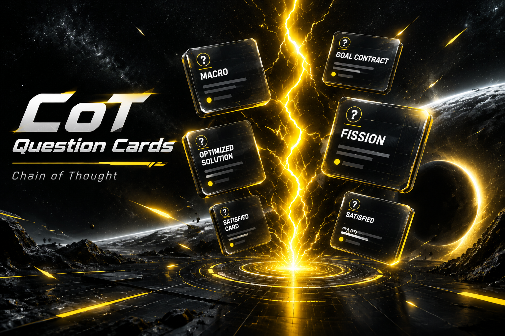
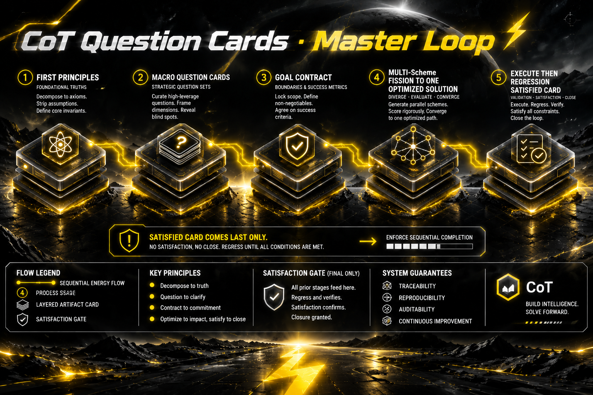

# CoT Question Cards

**CoT Question Cards** (Chain of Thought Question Cards) is a public Agent Skill (`SKILL.md`) for plan alignment and design interview work. Skill id: `question-cards` (compat alias `cot-question-cards`). Companion for one-off A/B/C picks: `choice-cards`. Chinese product name: **闪电问**.

[](LICENSE)
[](#installation)
[](#installation)
[](#versus-grill-me-grilling-and-host-primitives)
[](#v2-master-loop)

**Repository:** [https://github.com/StockOnLLC/cot-question-cards](https://github.com/StockOnLLC/cot-question-cards)

<p align="center">
  
</p>





**Skill bodies**

- Canonical loop: [`skills/question-cards/SKILL.md`](./skills/question-cards/SKILL.md)
- Compat alias: [`skills/cot-question-cards/SKILL.md`](./skills/cot-question-cards/SKILL.md)
- Lightweight companion: [`skills/choice-cards/SKILL.md`](./skills/choice-cards/SKILL.md)

---

## What CoT Question Cards does

Teams searching for **grill-me**, **grilling**, **grill-with-docs**, **AskUserQuestion**, **AskQuestion**, **request_user_input**, **choice-cards**, **Socratic interview**, **plan alignment**, **design interview**, **spec sharpening**, **product discovery**, **agentskills**, and **Agent Skills** want structured cards that sharpen a plan without dumping half-baked schemes mid-loop.

**CoT Question Cards** keeps that card UX neighborhood while enforcing a V2 Master Loop:

1. **Fuzzy goal + samples / research** — lock a rough effect and concrete analogs first  
2. **Concrete macros** — cover product surface, cadence, granularity, scope, bedrock, cost of being wrong  
3. **Agent-private fission** — expand 2–5 schemes, self-test, keep **one champion draft**  
4. **Micro structure cards** — refine load-bearing micro structure with the user  
5. **Satisfied loop** — after Optimized Solution ships; if unsatisfied → re-ask macros → micro again until fully satisfied  

Outputs: **Fuzzy Brief**, **Goal Contract**, unique **Optimized Solution**, execution record, and a satisfied-loop regression trail.

---

## V2 Master Loop

| Phase | Name | Who answers | What ships |
| --- | --- | --- | --- |
| F | Fuzzy goal + samples／research | User (cards) | Fuzzy Brief (private) |
| 1 | Concrete macros | User (2–5 cards) | Goal Contract (private) |
| 2 | Agent fission | Agent only | Champion Draft |
| 3 | Micro structure | User (≤3／round) | Revised Optimized Solution + execute |
| S | Satisfied loop | User | Close, or re-macro → micro → satisfied again |

Plain sequence: fuzzy → samples or research → cover-all macros → private fission → micro cards → satisfied; if not satisfied, ask more macro, then micro, until satisfied.

### Hard rules

- Satisfied cards **never** mix into the first fuzzy／macro decks; they appear only after there is delivered／executed output  
- Mid-fission **forbids** multi-scheme user votes (fission = Agent-private; micro cards = after champion draft)  
- Cards follow **user language**; Skill body is bilingual EN+ZH  
- **No** question numbering with `①` `②` `③` or Q1  
- **No** leading `❓` `❗` `🚨` (or similar) before the question text  
- Color marks 🟢🟡🔴🔵 define **meaning only**, unlimited count／ratio (multiple greens OK)  
- Grok Bot **must** use native `type:widget`; never fake clickable cards with markdown bullets  
- Option **labels** stay short; option **descriptions** are long enough to answer “选这个等于什么／会怎样”

### Versus V1

| Old V1 | V2 |
| --- | --- |
| Start at dense macros | Start at **fuzzy + samples／research** |
| Micro never asked of the user | Micro asked **after** champion draft |
| Satisfied only once post-execute | Satisfied **loops**: unsatisfied → re-macro → micro → satisfied again |
| No explicit research fork | Research when the fuzzy goal mixes tool-kinds |

---

## Versus grill-me, grilling, and host primitives

| Dimension | grill-me / grilling (typical) | AskUserQuestion / AskQuestion / request_user_input alone | choice-cards | CoT Question Cards |
| --- | --- | --- | --- | --- |
| Primary job | Relentless interview | Collect answers via UI | One-off A/B/C | Plan／design alignment with V2 timing |
| Mid-fission votes | Often yes | Possible if author dumps schemes | N/A | **Forbidden** |
| Satisfied timing | Often early or ad hoc | Author-dependent | N/A | **Satisfied loop after Optimized Solution** |
| Product name | Grill family | Host primitive | Companion skill | **CoT Question Cards**／闪电问 |

CoT Question Cards uses the same host primitives (`AskUserQuestion`, `AskQuestion`, `request_user_input`, Grok `widget`, OpenCode `question`, Gemini `ask_user`, CoTree target-host primitives) while owning a distinct loop name, Goal Contract, unique Optimized Solution, and satisfied loop.

---

## Phase detail

### Phase F · Fuzzy goal + samples

Always first. Lock a *rough* effect — what success should feel like — plus samples or research analogs. If the fuzzy goal mixes multiple tool-kinds, research public analogs, let the user pick which to lean on (multiple greens OK), then enter concrete macros. Skip research when the user already pasted samples. Forbidden in Phase F: satisfied cards, API／component／token-level detail, treating the fuzzy goal as an acceptance checklist.

### Phase 1 · Concrete macros

Ask until aspects are covered: success criteria, audience／non-audience, cadence, granularity, bedrock constraints, cost of being wrong. Round size 2–5 load-bearing cards. Do not ask micro implementation yet. After answers, the Agent privately writes the **Goal Contract** (success／scope／bedrock／gates／sample refs) with **no** confirm card, then enters Phase 2.

### Phase 2 · Agent fission (no user cards)

From Goal Contract + samples: seed ≤3 levers → expand **2–5** schemes → self-test against gates → pick **one champion draft**. Forbidden: mid-fission “A or B?” preference polls.

### Phase 3 · Micro structure

Only after a champion draft exists. Ask load-bearing micro structure (information architecture, cadence triggers, granularity bands, key state machines) — ≤3 cards／round. If answers contradict the Goal Contract, jump back to Phase 1 macros. Revise the champion into the unique **Optimized Solution** and **execute** what can ship now.

### Phase S · Satisfied loop

Only after the Optimized Solution is delivered／executed:

- 🟢 Satisfied — adopt and close  
- 🟡 Unsatisfied — say what is wrong → Agent returns to **more macro** → Phase 2 → Phase 3 → satisfied again  
- 🔴 Macro／samples wrong → back to Phase F or Phase 1  
- 🔵 Expand  

Loop until fully satisfied. Two unsatisfied rounds that are actually fuzzy-goal wrong force Phase F.

---

## Card UX and platform primitives

| Host | Primitive |
| --- | --- |
| Grok Bot (desktop) | `type:widget` — `prompt` + `options`; 🟢→`style:primary`; 🔴→`style:danger`; `allowCustom`; multi-Q via `steps` |
| Grok Bot (iOS／Android) | **Same** widget API; title-only／blank option bodies = **client render bug** — use desktop or typed reply; do not switch to markdown fake buttons |
| Claude Code | `AskUserQuestion` |
| Cursor | `AskQuestion` (required when available in the session) |
| Codex | `request_user_input` |
| OpenCode | `question` |
| Gemini CLI | `ask_user` |
| CoTree／contree | Install into the **target host** and use that host’s primitive (CoTree itself does not render cards) |
| Other／missing primitive | Text card with color marks, labeled 非可点／non-clickable |

Color marks (meaning only, unlimited ratio):

| Mark | Meaning |
| --- | --- |
| 🟢 | Best／recommended |
| 🟡 | Acceptable／doable with cost |
| 🔴 | Risky／not recommended |
| 🔵 | Need expand — explain, then more cards |

Usually 3–5 substance options + 🔵 when useful + host `allowCustom`. No `A｜` prefixes when the host already shows letters. Prefer swipe `steps` for multi-Q; keep Phases F／1／3／S in **separate** decks.

---

## Installation

Folder name must equal frontmatter `name`: **`question-cards`**. New installs copy `skills/question-cards`. Compat path `skills/cot-question-cards` still resolves older installs. Companion: `skills/choice-cards`.

```bash
git clone https://github.com/StockOnLLC/cot-question-cards.git
cd cot-question-cards

# Claude Code / Coco
mkdir -p ~/.claude/skills && cp -R skills/question-cards ~/.claude/skills/question-cards

# Cursor (both roots recommended)
mkdir -p ~/.cursor/skills ~/.agents/skills
cp -R skills/question-cards ~/.cursor/skills/question-cards
cp -R skills/question-cards ~/.agents/skills/question-cards

# OpenAI Codex
mkdir -p ~/.codex/skills && cp -R skills/question-cards ~/.codex/skills/question-cards

# WorkBuddy / CodeBuddy
mkdir -p ~/.codebuddy/skills && cp -R skills/question-cards ~/.codebuddy/skills/question-cards

# OpenCode
mkdir -p ~/.opencode/skills && cp -R skills/question-cards ~/.opencode/skills/question-cards

# Gemini CLI
mkdir -p ~/.gemini/skills && cp -R skills/question-cards ~/.gemini/skills/question-cards

# Universal installer (when supported)
# npx skills add StockOnLLC/cot-question-cards
```

Also works as an Agent Skill／SKILL.md on Windsurf, Cline, Continue, Trae, Zed, Copilot, Roo, Goose, Amp, Junie, AiderDesk, Cortex, Grok Bot, Kiro, Warp, Antigravity, and similar hosts that load `SKILL.md` folders. For CoTree／contree, copy the same folder into each host directory the contree spec points at (`claude:~`, `codex:~`, `opencode:~`, `amp:~`, `cline:~`). Web IDEs (Codespaces／Gitpod): commit `.agents/skills/question-cards` into the project, or paste `SKILL.md` into custom agent instructions.

Optional pointers in `CLAUDE.md`／`AGENTS.md`: load CoT Question Cards for plan／design alignment; do not dump the whole loop into every rules file.

Smoke test: Phase F／1 decks must not contain a satisfied option; after Optimized Solution execute, Phase S must appear; mid-fission must not present multi-scheme votes.

---

## Suite layout

```
skills/
  question-cards/SKILL.md      # canonical CoT Question Cards V2
  cot-question-cards/SKILL.md  # thin compat alias → question-cards
  choice-cards/SKILL.md        # one-off A/B/C; prefer question-cards for trees
docs/brand/                    # hero + loop + fission + layering + vs grill + IDE + 字标
LICENSE
README.md
```

---

## End artifact template

```markdown
## Fuzzy Brief／糊目标简报
- Rough effect: …
- Samples／analogs: …

## Goal Contract／目标契约
- Success／Scope／Bedrock／Gates: …

## Optimized Solution／最优方案（唯一项）
…

## Internal bake-off／比选摘要
- Variants: N; Passed: M; Winner: …

## Micro refinements／微观修订
…

## Execution／执行记录
→ What shipped: …

## Regression／满意循环
→ Satisfied close | Feedback → re-macro round k
```

---

## Anti-patterns

| Illegal | Why |
| --- | --- |
| Satisfied card inside Phase F／1 swipe | Breaks satisfied loop timing |
| Mid-fission “pick Scheme B or D” | Turns Agent into a waiter; no gates |
| Numbering questions `①②③`／Q1 | Hurts card aesthetics／host layout |
| Leading `❓` `❗` `🚨` on question text | Noise; write the question sentence only |
| Markdown bullets as fake Grok cards | Must use `type:widget` |
| Forced one-green-one-yellow-one-red | Color marks are meaning-only; multiple greens OK |
| Mixing macro and micro in one deck | False precision before Goal Contract |
| Branding the product as Grill | Distinct name: CoT Question Cards／闪电问 |

---

## SEO and discovery neighborhood

CoT Question Cards sits in the Agent Skills／`SKILL.md`／agentskills／`npx skills add` neighborhood alongside searches for grill-me, grilling, AskUserQuestion, AskQuestion, request_user_input, choice-cards, Goal Contract, Optimized Solution, plan alignment, design interview, Claude Code skills, Cursor skills, Codex skills, OpenCode question, Gemini ask_user, CoTree contree, Grok widget, and Socratic product discovery. Related packaging names (anthropics/skills, Terminal Skills, Matt Pocock-style skill ecosystems) describe discovery channels — this repo owns the **CoT Question Cards** loop, not those brands.

---

## FAQ

**Is CoT Question Cards just grill-me renamed?**  
No. Same card UX neighborhood; different V2 timing, Goal Contract, unique Optimized Solution, and satisfied loop.

**Can I still use AskUserQuestion / AskQuestion / request_user_input?**  
Yes — as host primitives inside the V2 phases. CoT Question Cards is the timing discipline.

**When is the Satisfied Card allowed?**  
Only in Phase S after Optimized Solution delivery／execution. Unsatisfied answers loop back to more macro, then micro, then satisfied again — not a single one-shot post-execute ask.

**How does choice-cards relate?**  
One-off A/B/C. Decision trees and plan alignment → CoT Question Cards (`question-cards`).

**Grok mobile shows title-only blank options?**  
Client render bug. Same `type:widget` API as desktop; ask the user to open on desktop or type the option text. Do not fake buttons in markdown.

**Folder／id?**  
`question-cards` (frontmatter `name` must match). Compat: `cot-question-cards`.

---

## Glossary

| Term | Meaning |
| --- | --- |
| CoT Question Cards | English product name (this repo) |
| 闪电问 | Chinese product name |
| Question Cards／问题卡 | Skill body external name (never Grill) |
| Fuzzy Brief | Phase F private rough-effect + samples summary |
| Goal Contract | Phase 1 private success／scope／bedrock／gates artifact |
| Champion Draft | Phase 2 unique draft before micro |
| Optimized Solution | Unique champion after micro + execute |
| Satisfied loop | Phase S; unsatisfied → re-macro → micro → satisfied |
| choice-cards | Companion one-off pick skill |
| Agent Skills／SKILL.md | Packaging format |

---

## Contributing

Pull requests that clarify V2 timing, host install paths, Goal Contract examples, or platform primitive tables are welcome. Keep behavior changes in sync with [`skills/question-cards/SKILL.md`](./skills/question-cards/SKILL.md). File timing bugs with host name, transcript snippet, and which phase showed a Satisfied Card or mid-fission vote too early.

---

## License

MIT — see [LICENSE](LICENSE). Copyright (c) 2026 StockOn.

---

## Links

- Repo: [https://github.com/StockOnLLC/cot-question-cards](https://github.com/StockOnLLC/cot-question-cards)
- Core: [`skills/question-cards/SKILL.md`](./skills/question-cards/SKILL.md)
- Compat: [`skills/cot-question-cards/SKILL.md`](./skills/cot-question-cards/SKILL.md)
- Companion: [`skills/choice-cards/SKILL.md`](./skills/choice-cards/SKILL.md)

---

# Chinese appendix

<p align="center">
  
</p>

## 闪电问是什么

**闪电问**是 **CoT Question Cards**（Chain of Thought Question Cards）的中文产品名。Skill id：`question-cards`（兼容 `cot-question-cards`）。配套单次选择：`choice-cards`。

闪电问是一套公开 Agent Skill（`SKILL.md`），用来对齐计划或设计：先糊目标＋样本／调研，再具象宏观，再由 Agent 内部裂变自测出冠军草案，再出微观结构卡，落地唯一最优方案后进入**满意循环**——不满意就回到更宏观重问，再微观，直到满意。

## V2 总序（必须按序）

1. **糊目标＋样本／调研** — 大致效果 + 参照样本或 Agent 调研类似物  
2. **具象宏观** — 面面盖到（产品面、节奏、颗粒度、范围、基岩、做错代价）  
3. **Agent 内裂变自测** — 扩 2–5 案、自测、只留冠军草案（禁止中途多方案投票）  
4. **微观结构卡** — 对冠军草案问承重微观结构（≤3 题／轮）  
5. **满意循环** — 有产出／执行之后才问；不满 → 宏观重问 → 微观 → 再满意，轮询到满意  

## 硬规则

- 满意卡**禁止**塞进第一轮糊目标／宏观滑组  
- 裂变中途**禁止**半成品多方案让用户投票  
- 题目前不加 `①` `②` `③`／Q1  
- 题目前禁止 `❓` `❗` `🚨`  
- 🟢🟡🔴🔵 只定含义，不限个数／配比（可三绿）  
- Grok **必须** `type:widget`，禁止 markdown 子弹冒充可点卡  
- 选项短 label + **长** description（选这个等于什么）  

## 平台原语

| 宿主 | 原语 |
| --- | --- |
| Grok Bot | `type:widget`（手机标题空白＝客户端 bug，改桌面或打字） |
| Claude Code | `AskUserQuestion` |
| Cursor | `AskQuestion` |
| Codex | `request_user_input` |
| OpenCode | `question` |
| Gemini CLI | `ask_user` |
| CoTree | 装进目标宿主后用该宿主原语 |

## 安装（摘要）

```bash
git clone https://github.com/StockOnLLC/cot-question-cards.git
cd cot-question-cards
mkdir -p ~/.claude/skills && cp -R skills/question-cards ~/.claude/skills/question-cards
mkdir -p ~/.cursor/skills ~/.agents/skills
cp -R skills/question-cards ~/.cursor/skills/question-cards
cp -R skills/question-cards ~/.agents/skills/question-cards
mkdir -p ~/.codex/skills && cp -R skills/question-cards ~/.codex/skills/question-cards
# 亦可用：npx skills add StockOnLLC/cot-question-cards
```

文件夹名必须等于 frontmatter `name`：`question-cards`。新安装优先 `skills/question-cards`；`skills/cot-question-cards` 仅为兼容别名。

## 和 grill-me／AskUserQuestion 的关系

卡片交互可以同类（AskUserQuestion／AskQuestion／request_user_input／Grok widget／OpenCode question／Gemini ask_user），但**时序与产出不同**：不叫 Grill；不中途投票；先糊目标与样本，再宏观，再裂变，再微观，落地后再进满意循环。英文产品名 **CoT Question Cards**，中文产品名 **闪电问**。

## 许可

MIT — 见 [LICENSE](LICENSE)。

仓库：[https://github.com/StockOnLLC/cot-question-cards](https://github.com/StockOnLLC/cot-question-cards)
